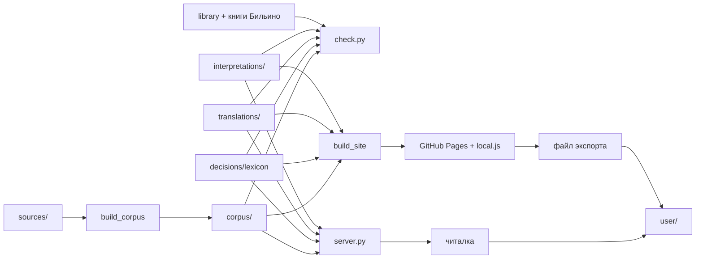

# Карта системы (аудит 24.10.2026)

## Программы

| Программа | Назначение | Вход |
|---|---|---|
| `tools/fetch_sources.py` | скачать исходники зафиксированных версий, паспорта (SHA-256, лицензии) | интернет → `sources/` |
| `tools/build_corpus.py` (+ `hebrew.py`, `versification.py`) | собрать корпус: стихи, слова, морфемы, транслитерация, Синодальный по стихам, словарные статьи | `sources/` → `corpus/` |
| `tools/check.py` (+ `books.py`) | проверить словарь, переводы, трактовки по правилам; найти цитаты в книгах | всё → отчёт |
| `tools/compile_chapter.py`, `dump_chapter.py` | подготовка главы Claude-ом | corpus, lexicon → translations |
| `tools/build_site.py` | статический сайт для телефона | всё → `site/` (собирает GitHub Actions) |
| `tools/audit_synodal.py` | сверка сопоставления с Синодальным по именам | corpus |
| `app/server.py` + `app/static/*` | читалка на 127.0.0.1:8795; пишет только в `user/` | всё |
| `app/static/local.js` | те же запросы `/api/...` без сервера (сайт) | `site/data/`, память браузера |

## Данные

| Данные | Кто пишет | Кто читает | Объём | Исходные / производные |
|---|---|---|---|---|
| `sources/` | fetch_sources | build_corpus | 70 МБ | исходные (внешние, с паспортами) |
| `corpus/` | build_corpus | всё | ~300 тыс. слов, 9248 словарных слов | производные, сборка детерминирована (проверено: два прогона дают один SHA-256) |
| `decisions/lexicon/*.json` | Claude | check, server, site | 2751 файл | исходные (решения) |
| `translations/ot/<Книга>/<ггг>.json` | Claude | check, server, site | 117 глав (Быт, Исх, Лев) | исходные |
| `interpretations/*.json` | Claude | check, server, site | 613 (457 Лопухин, 156 Бильино) | исходные |
| `library/books.json`, `library/texts/` | Claude | check (поиск цитат) | 3 текста Лопухина; книги Бильино — вне репозитория | исходные |
| `user/*.json`, `history.jsonl` | только читалка | Claude, читалка | — | данные пользователя |
| `site/` | build_site | GitHub Pages | 79 МБ | производные |

## Поток

## Что «вычисляется» (инвентарь проверок)

1. Транслитерация (`hebrew.translit`), только для карточки.
2. Сопоставление нумерации стихов WLC ↔ Синодальный (`versification.py`).
3. Проверки правил в `check.py`: каждое слово передано; имена и титулы не переведены; значение из словаря и русское слово узнаётся по основам (`stems`); `ve-` → «и»; места-свидетельства существуют; цитата есть в книге.
4. Отбор трактовок для карточки (по словарной форме или по месту).
5. Слияние данных пользователя при импорте (по дате записи).
